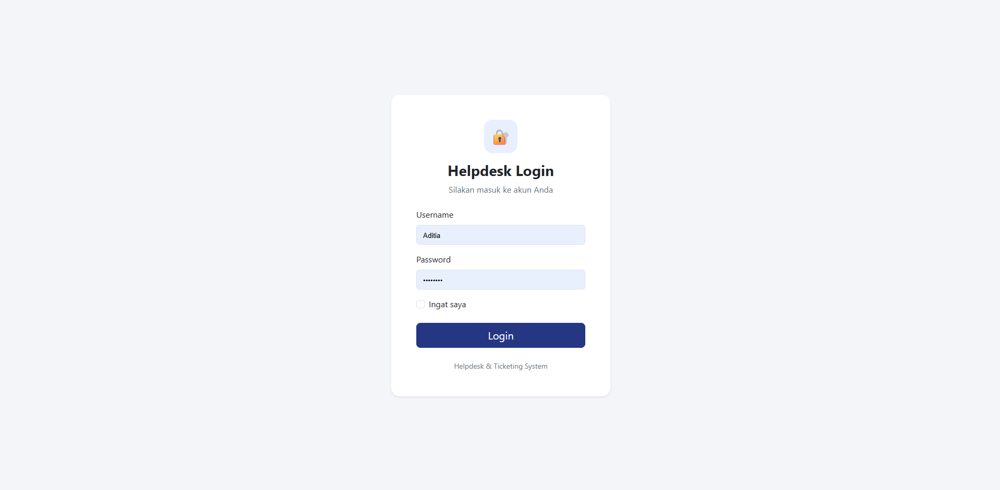
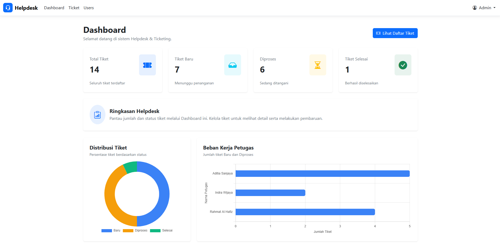
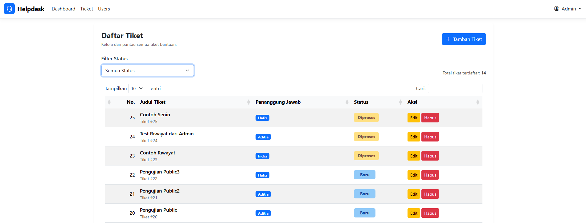
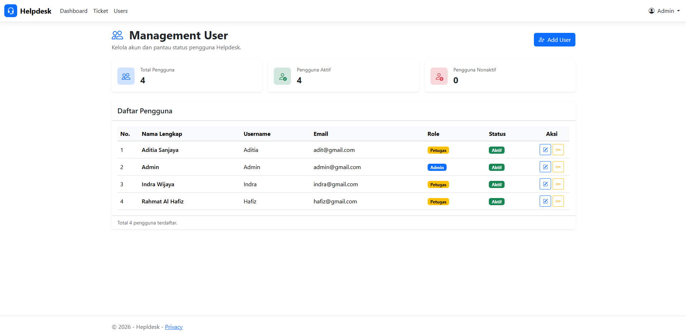
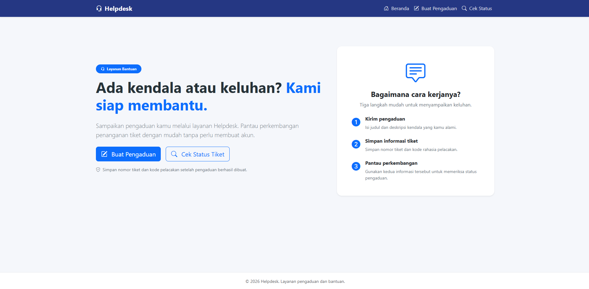
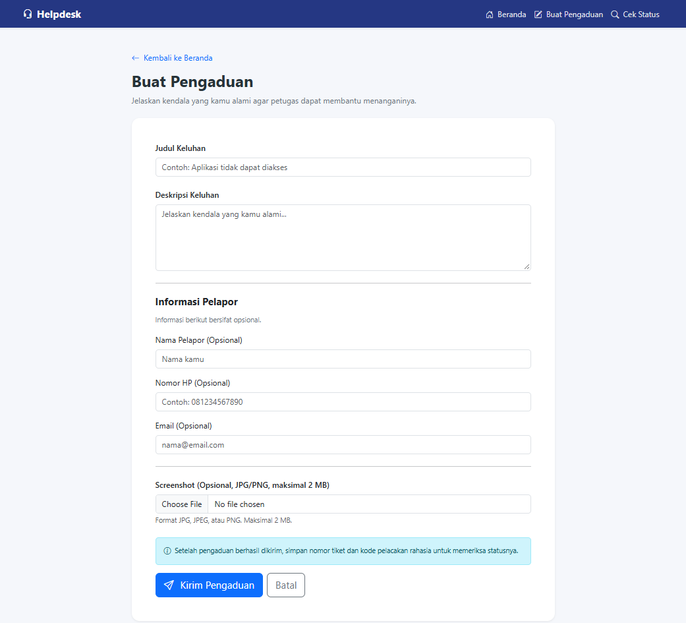
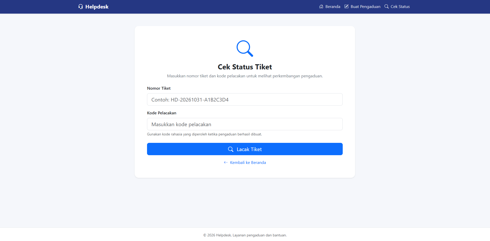
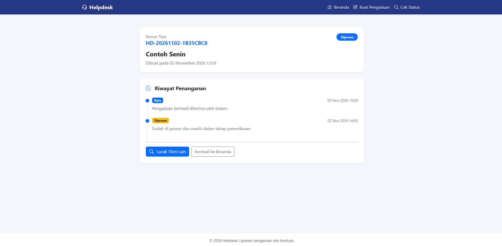

# Helpdesk - ASP.NET Core MVC

Aplikasi **Helpdesk and Ticketing System** berbasis ASP.NET Core MVC yang dirancang untuk membantu pengelolaan laporan permasalahan, penugasan petugas, pemantauan status tiket, dan pelacakan tiket secara publik.

## 📌 Deskripsi Project

Helpdesk merupakan aplikasi ticketing system yang memungkinkan Admin mengelola tiket permasalahan dan menugaskan tiket kepada Petugas. Petugas dapat menangani tiket yang menjadi tanggung jawabnya, sementara pelapor dapat membuat laporan dan memantau perkembangan tiket melalui fitur pelacakan publik.

Project ini juga menyediakan REST API untuk pengelolaan data tiket dengan mekanisme autentikasi dan otorisasi berdasarkan role pengguna.

## ✨ Fitur Utama

### 1. Authentication & Authorization
- Login menggunakan ASP.NET Core Identity.
- Manajemen role Admin dan Petugas.
- Pengelolaan akun pengguna oleh Admin.
- Aktivasi dan deaktivasi akun pengguna.
- Pembatasan akses berdasarkan role.

### 2. Ticket Management
- Membuat, melihat, mengubah, dan menghapus tiket.
- Admin dapat melihat seluruh tiket internal.
- Petugas hanya dapat melihat tiket yang ditugaskan kepadanya.
- Admin dapat menugaskan tiket kepada Petugas.
- Pengelolaan status tiket: Baru, Diproses, dan Selesai.
- Setiap perubahan status disertai keterangan dan riwayat perubahan.

### 3. Public Ticket & Tracking
- Formulir pengaduan yang dapat diakses tanpa login.
- Pembuatan nomor tiket publik.
- Pelacakan tiket menggunakan nomor tiket dan kode pelacakan.
- Riwayat perkembangan status tiket.
- Pengaturan izin pelacakan publik oleh Admin.

### 4. Dashboard
- Ringkasan jumlah tiket.
- Visualisasi tiket berdasarkan status menggunakan donut chart.
- Visualisasi jumlah tiket yang sedang ditangani setiap Petugas menggunakan horizontal bar chart.

### 5. Screenshot Attachment
- Upload screenshot pendukung tiket.
- Validasi format JPG, JPEG, dan PNG.
- Batas ukuran file maksimal 2 MB.

### 6. REST API
Menyediakan endpoint untuk pengelolaan tiket:

| Method | Endpoint | Fungsi |
|---|---|---|
| GET | `/api/tickets` | Mengambil daftar tiket |
| GET | `/api/tickets/{id}` | Mengambil detail tiket |
| POST | `/api/tickets` | Membuat tiket |
| PUT | `/api/tickets/{id}` | Memperbarui tiket |
| DELETE | `/api/tickets/{id}` | Menghapus tiket |

REST API menggunakan JSON sebagai format pertukaran data serta HTTP status code untuk menunjukkan hasil permintaan.

## 🛠️ Teknologi yang Digunakan

- C#
- ASP.NET Core MVC (.NET 10)
- Entity Framework Core
- SQL Server
- ASP.NET Core Identity
- Bootstrap
- JavaScript
- Chart.js
- DataTables
- SweetAlert
- ImageSharp
- Postman

## 📸 Application Screenshots

### 1. Authentication


### 2. Admin Dashboard & Management







### 3. Public Complaint





### 4. Ticket Tracking





## ⚙️ Persyaratan Sistem

Sebelum menjalankan aplikasi, pastikan perangkat sudah memiliki:

- .NET 10 SDK
- SQL Server
- Visual Studio 2026 atau IDE yang mendukung .NET 10
- SQL Server Management Studio (opsional)
- Git

## 🚀 Instalasi dan Konfigurasi

### 1. Clone Repository

```bash
git clone https://github.com/aditia27-sanjaya/Helpdesk.git
```

### 2. Buka Project

Buka file `Hepldesk.sln` menggunakan Visual Studio.

### 3. Konfigurasi User Secrets

Atur koneksi database menggunakan .NET User Secrets agar informasi koneksi tidak disimpan di repository.

Buka terminal pada folder project, kemudian jalankan:

```bash
dotnet user-secrets init
```

Tambahkan connection string:

```bash
dotnet user-secrets set "ConnectionStrings:DefaultConnection" "Server=YOUR_SERVER;Database=HelpdeskDB;Trusted_Connection=True;TrustServerCertificate=True;"
```

Sesuaikan `YOUR_SERVER` dengan nama server SQL Server yang digunakan.

### 4. Update Database

Jalankan perintah berikut pada folder project:

```bash
dotnet ef database update
```

### 5. Jalankan Aplikasi

```bash
dotnet run
```

Aplikasi kemudian dapat diakses melalui alamat lokal yang ditampilkan oleh ASP.NET Core.

## 🔐 Hak Akses Pengguna

| Role | Hak Akses |
|---|---|
| Admin | Mengelola pengguna, membuat dan mengelola tiket internal, menugaskan Petugas, serta mengatur pelacakan publik |
| Petugas | Melihat dan menangani tiket yang ditugaskan kepadanya |

## 🧪 Pengujian REST API

Pengujian REST API dilakukan menggunakan **Postman**, termasuk pengujian:
- GET, POST, PUT, dan DELETE.
- Autentikasi pengguna.
- Pembatasan akses berdasarkan role.
- Validasi data.
- HTTP status code dan respons JSON.

## 📁 Struktur Project

```text
Hepldesk/
├── Controllers/
├── Data/
├── Migrations/
├── Models/
│   └── DTOs/
├── Views/
├── wwwroot/
├── appsettings.example.json
├── Program.cs
└── Hepldesk.csproj
```

## 👨‍💻 Developer

**Aditia Sanjaya**

GitHub: [@aditia27-sanjaya](https://github.com/aditia27-sanjaya)

---

*This project was developed as a learning and portfolio project for ASP.NET Core MVC, database management, authentication, authorization, and REST API development.*
